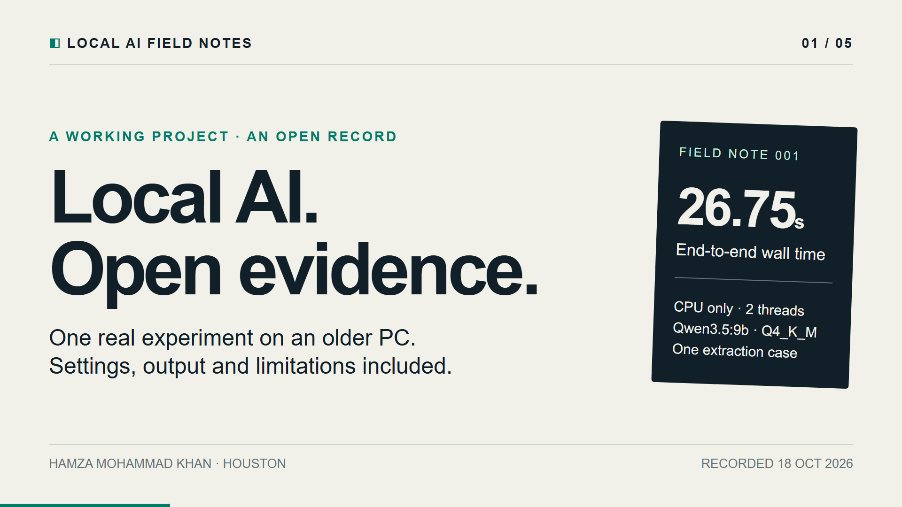

# Local AI Field Notes

**Small, inspectable experiments for people using ordinary computers.**



A Python standard-library runner and self-contained HTML report for local
Ollama-compatible model servers. It records the prompt, configuration, raw
answer, completion status and the timing evidence behind each result.

This is an early independent project by Hamza Mohammad Khan, Houston, Texas.
AI-assisted development is used. A creator channel and broader hardware study
are planned; no creator audience or sponsor approval is claimed.

## First measured record

The [raw extraction run](examples/2026-10-18-cpu-extraction.json) is a real,
single-case run on October 18, 2026: Qwen3.5:9b, Ollama 0.32.9, Q4_K_M,
i7-8700K desktop, 32 GB RAM, **CPU only with two threads**. The strict fictional
event-extraction check passed. Client wall time was 26.752 seconds, first answer
content arrived after 19.293 seconds, and the runtime reported 3.486 output
tokens/second during generation. Runtime-reported model load was 14.793 seconds.
This is one small observation, not a hardware ranking or a claim about general
model quality. It does not benchmark the desktop's GTX 1080 Ti.

An [offline HTML report](examples/2026-10-18-cpu-extraction.html) and the
[two-page project proposal](docs/project-brief.pdf) are included.

## Reviewer demonstration

The [five-scene storyboard](docs/storyboard.md) presents this same measured
record, its settings and the narrow extraction check. The [editable one-minute
preview source](demo/README.md) uses Remotion 4.0.536, with each scene available
on its own timeline. It is a silent preview with scene stills; narration and a
published creator-channel episode are future work.

## A second local model: visible failures included

Qwen2.5:0.5b was downloaded from the official Ollama library and tested on the
same desktop, CPU only with two threads, context 512 and an output cap of 128.
The [raw three-case record](examples/2026-10-18-qwen2.5-0.5b-cpu.json) and
[offline report](examples/2026-10-18-qwen2.5-0.5b-cpu.html) preserve all responses.

| Case | Recorded result | Visible observation |
|---|---|---|
| Strict event JSON | Fail | Values match, but Markdown code fences violate the request for only valid JSON. |
| Short library summary | Mechanical pass | The answer meets the word limit and required-term checks. |
| Urdu assistance | Human review | The actual answer is in English; the requested Urdu was not provided. |

These are three observations with one run per case, not a general quality
score. The language note is a visible observation; the raw human-review flag is
retained. The model architecture and size differ from the Qwen3.5:9b record,
and the output cap is 128 rather than 64. Both records declare Q4_K_M precision.
Their timings do not constitute a hardware-only comparison.

## Qwen3.5:9b across all three cases

A later [three-case CPU run](examples/2026-10-18-qwen3.5-9b-cpu-three-cases.json)
and [offline report](examples/2026-10-18-qwen3.5-9b-cpu-three-cases.html)
record Qwen3.5:9b with two CPU threads, context 512, output cap 128 and
unload-after-each requests. All three requests completed. The strict JSON
check passed, and the summary passed its narrow mechanical checks.

The language case produced Urdu, while retaining the human-review flag.
Its closing statement that data will always be safe is too broad: saving
does not guarantee protection against every kind of data loss. This is a
useful visible limitation, not a perfect language-quality result.

Client wall times were 18.938, 18.793 and 35.143 seconds, respectively.
Each case has one observation; cache state and other desktop activity were
uncontrolled. This is not a controlled comparison with the earlier records.
No cloud allocation or new hardware was involved.

## Existing GPU access verified

A separate [automatic-placement run](examples/2026-10-18-qwen2.5-0.5b-auto.json)
completed the same three cases on the desktop's GTX 1080 Ti. The
[placement evidence](examples/2026-10-18-qwen2.5-0.5b-auto-placement.json)
records Ollama reporting all 434,099,977 loaded model bytes in VRAM. Driver
582.66 and Ollama 0.32.9 were observed. An
[offline report](examples/2026-10-18-qwen2.5-0.5b-auto.html) includes every answer.

The first request took 30.288 seconds, including a runtime-reported 20.690-second
load; the next two took 0.845 and 0.502 seconds. This run kept the model resident
for ten seconds between requests, unlike the CPU record's unload-after-each
setting. Cache state and other desktop activity were uncontrolled. These values
verify a usable local GPU path, not a controlled speed comparison. The model was
explicitly unloaded afterward.

GPU execution did not fix the answer failures: strict JSON still included code
fences, and the Urdu task still received English. No new hardware, donated
compute or broad model-quality improvement is claimed.

## Lemonade compatibility verified on the existing CPU

Portable Lemonade **2026.42.1**, with llama.cpp CPU backend b11393, completed
all three cases using a separate copy of the existing Qwen2.5:0.5b GGUF.
Native health confirmed CPU placement, context 512 and two threads. The
independently verified weights hash and cleanup evidence are in the
[provenance record](examples/2026-10-18-lemonade-provenance.json).

| Mode | Raw evidence | Observed result |
|---|---|---|
| Generate/completion | [JSON](examples/2026-10-18-lemonade-qwen2.5-0.5b-generate.json) · [HTML](examples/2026-10-18-lemonade-qwen2.5-0.5b-generate.html) | All completed at the output cap; extraction and summary failed, and Urdu was not supplied. |
| Explicit chat | [JSON](examples/2026-10-18-lemonade-qwen2.5-0.5b-chat.json) · [HTML](examples/2026-10-18-lemonade-qwen2.5-0.5b-chat.html) | All completed normally; JSON fences still failed strict extraction, summary passed mechanical checks, Urdu still received English. |

The task prompts and weights were retained. Completion and chat use distinct
request formats and prompt rendering. Their timings and outputs are not a
controlled hardware or general-quality comparison.

- The compatible /api/version returns **0.16.1**; native Lemonade health reports **2026.42.1**.
- The all-zero model digest is a placeholder. The original generate record
  retains that API response; it must not be treated as a weights hash.
- Streamed token counts and generation duration were unavailable. Runtime
  tokens/second remains unavailable.
- keep_alive=0 was requested, but native health still showed the model loaded
  after the chat cases. Explicit native unload emptied the model list, then
  the test server was stopped.

Version 0.2 adds explicit chat requests and Lemonade-native identity metadata.
It retains a reported zero digest separately and marks the content digest
unavailable. With an already-running, configured local Lemonade instance:

    python fieldnotes.py run \
      --endpoint http://127.0.0.1:13305 \
      --runtime-kind lemonade --api-mode chat \
      --model fieldnotes-qwen2.5-0.5b:latest \
      --cpu --threads 2 --context 512 --max-output-tokens 128 \
      --hardware-label "Your public hardware description" \
      --output my-lemonade-chat-run.json

Select your own downloaded model name from the compatible model list. For native
Lemonade CLI loading, use the ID from /v1/models; a compatible :latest alias can
differ. Configure and verify the native CPU backend and thread settings first:
client options alone do not prove enforcement.

This test used no AMD hardware, new cloud allocation or hardware award. AMD
membership, challenge eligibility and remaining award supply are separate.

## What works in the current release

A separate [free community inference example](docs/free-community-inference.md)
also completed a fictional JSON task through AI Horde's anonymous API. It can
be accessed from home through supported interfaces without a personal key or
local GPU, subject to availability and service filtering. A later Python-client
attempt received HTTP 403; that limitation is recorded. This is shared hosted
inference with a provider-reported model label, not a private GPU grant.

- Stream responses from an already-running local Ollama-compatible server.
- Keep client wall time separate from first-content latency and the runtime's
  own token-generation metrics.
- Check fictional structured extraction and summary constraints.
- Flag the Urdu task for human review rather than invent a language-quality score.
- Persist failed runs and reject incomplete streams.
- Produce an offline HTML report with escaped model output and explicit provenance.
- Limit requests to loopback endpoints. No API key is requested, read or stored.

## Quick start

Requires Python 3.10+ and an already-running model server. No Python dependencies
or package installation are needed.

```sh
python fieldnotes.py run \
  --model qwen3.5:9b \
  --hardware-label "My local desktop - CPU only" \
  --cpu --threads 2 --context 512 --max-output-tokens 128 \
  --case-id extract-event \
  --output runs/first-local-run.json

python fieldnotes.py report runs/first-local-run.json \
  --output runs/first-local-run.html
```

PowerShell users can place the command on one line or use PowerShell line
continuations. The model named above must already be installed; the runner
does not download models or launch a service.

Use a different `--endpoint http://127.0.0.1:PORT` for another local compatible
server. A remote machine can be used through a user-configured SSH tunnel.
The runner does not open ports or create tunnels.

`--keep-alive 0` requests unload after each generation. This does not establish
that the OS cache was cold. `--repeat 3` creates more observations, without
claiming a statistically reliable ranking. Choose an output filename that
does not already exist; overwriting requires an explicit flag.

## Evidence, not a leaderboard

| Field | Meaning |
|---|---|
| `wall_seconds` | Client-observed duration of the generation request |
| `first_content_seconds` | Time until the first non-empty answer content reaches the client |
| `runtime_generation_tokens_per_second` | Runtime-reported output tokens / runtime-reported generation time |
| `runtime_load_seconds` | Load duration reported by the server, when provided |
| `check` | A narrow mechanical result or a human-review requirement |
| `source` | `measured` or `fixture`; fixture output is not model performance |

The first-content metric is **not** a tokenizer-level first-token timestamp.
Runtime token accounting can vary. Failed or missing metrics remain visible.
The tool disables thinking in its request so answer latency has a declared
configuration; a server that rejects that option must be reported as unsupported,
not quietly retried with a different setup.

Do not compare runs as hardware-only experiments if model version, quantization,
prompt template, context size, runtime or generation settings differ.
The supplied checks do not establish general reasoning ability or semantic
correctness. The summary check only tests a word limit and named terms;
the Urdu task requires a transparent human review.

## Tests

```sh
python -m unittest -v
```

Tests use a temporary loopback HTTP fixture. They verify streaming, truncated
responses, JSON types, provenance, output escaping, local endpoint restrictions,
overwrite protection and the raw-JSON-to-HTML workflow. Fixture timings do not
benchmark a real model.

## Scope and next steps

The initial task set covers strict extraction, constrained summarization and
English-to-Urdu assistance. Next steps are broader validation and reproduction
on another machine. Lemonade compatibility is verified only for the small
CPU configuration documented above; other versions and devices need their own checks.

The proposed first support request is a modest compute-credit grant or a
returnable review system, to extend reproducible tests and educational
walkthroughs. No sponsor approval or equipment award is claimed.

## Protocol references

- [Ollama generate API](https://docs.ollama.com/api/generate)
- [Ollama chat API](https://docs.ollama.com/api/chat)
- [Lemonade API overview](https://lemonade-server.ai/docs/api/)
- [Lemonade Ollama-compatible API](https://lemonade-server.ai/docs/api/ollama/)

## Contact and license

Hamza Mohammad Khan · [GitHub](https://github.com/hkay26) ·
[hamzadedon@gmail.com](mailto:hamzadedon@gmail.com)

MIT license. Cases are fictional and contain no personal records.
