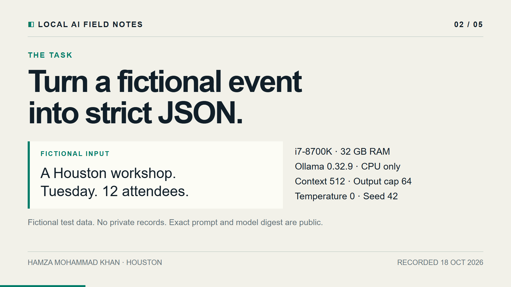
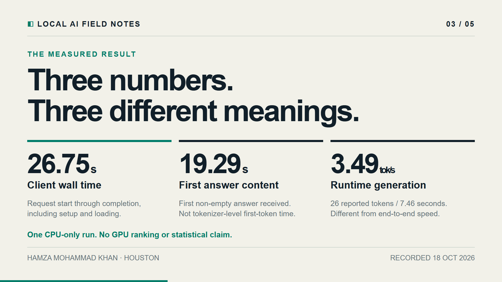
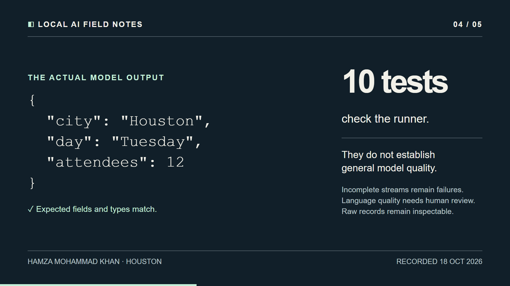
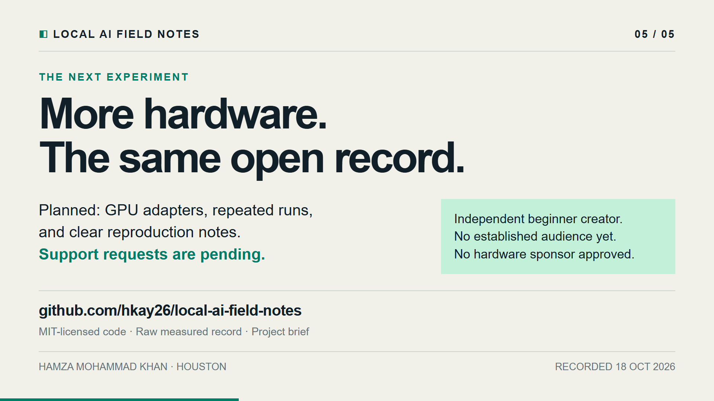

# Field Note 001 — reviewer storyboard

This is a five-scene visual explanation of the **single measured CPU-only
record** from October 18, 2026. It is an educational preview, not a hardware
ranking or a sponsor announcement. All timings trace to the [raw record](../examples/2026-10-18-cpu-extraction.json).

## 1. Local AI, open evidence

## 2. One fictional extraction task

## 3. Different timing measurements

## 4. Output and verification limits

## 5. Proposed next experiments

The code and visuals were developed with AI coding assistance. Layouts were
checked in Remotion Studio and as five 1920×1080 still frames. Lint and TypeScript
checks passed. [Preview source and setup](../demo/README.md).
